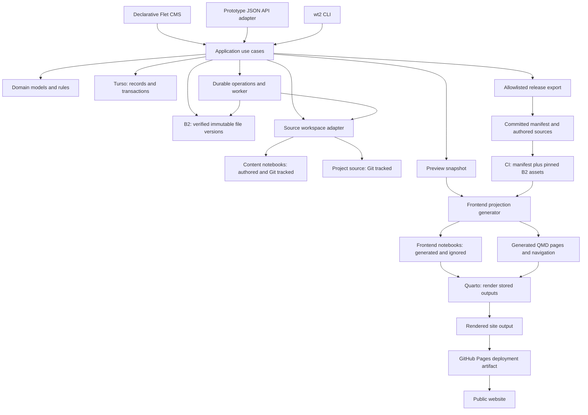
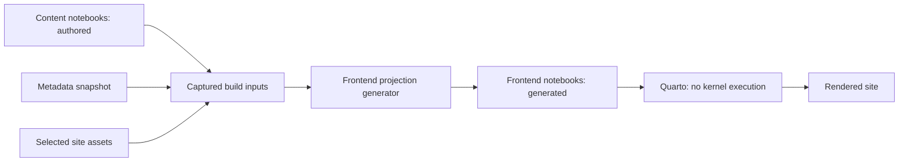

# 2. Target architecture

[Plan index](README.md) · Next: [retention and garbage collection](retention-and-gc.md)

Everything below is proposed. Provider capabilities must be demonstrated before
the schema and driver choice become implementation decisions.

This is a separate prototype informed by reverse engineering v1. Build and test
against isolated records, object namespaces, content copies/worktrees and outputs.
Do not replace v1 services or point the prototype at the active authoring store.
Adoption, live data movement and production deployment changes require a future
decision. Database schema migrations below concern the prototype's own evolution.

## Application shape

Keep adapters small. A Flet action and a CLI command call the same use case, such
as Start artifact or Attach context file. The use case enforces rules and
coordinates storage. Domain models describe valid states without importing
Flet, FastAPI, a database SDK, or the filesystem. The CLI runs independently of
the Flet runtime; neither interface invokes the other to perform application work.

Start with a few boundaries: database transaction/read operations, blob storage,
source workspace, and renderer. Avoid a generic framework or a separate
repository class for every table. Durable jobs can live in Turso with a worker
from the same application package; a separate queue service is unnecessary at
this scale.

GC tasks run in the local backend during active use, including CLI-triggered
cleanup without Flet. They need no always-on host while the laptop is closed;
expired retention can be reconciled on the next startup/resume.

A shared backend deletion service handles direct object removal and policy-driven
GC. CLI v2, Flet and workers submit intents to it; the service checks owners and
retention, claims eligible versions, deletes bytes and records outcomes. Direct
deletion is a supported application action with visible blocked/pending/completed
states. It does not require independently editing database rows or storage keys.
Managed deletion through the filesystem, direct SQL or B2 console is reserved
for explicit repair. Missing authoritative bytes are an integrity fault, not an
instruction to remove ownership records. Editors still own content notebook/code
editing; registered entity retirement remains a backend operation.

### What remains reusable

Study validated domain rules, workflows, notebook utilities, public-site templates,
Quarto generation and CLI intent. Reuse well-understood helpers where appropriate;
explain and review redesigns rather than copying unknown behavior. Build the
prototype's Flet presentation and persistence independently. A read-only v1
adapter/captured fixture can support comparisons; it never becomes another writer
to the active workspace. No existing caller is switched to the new backend by
this prototype plan.

Build the backend use case and CLI command first for each feature, then connect
its Flet controls. An early Flet screen verifies the interface boundary before
the complete CLI is finished. See [CLI v2 and Flet](cli-v2-and-flet.md) for state
ownership, command contracts, the feasibility checklist, and UI parity adjustments.

Validation becomes scoped to the action's affected records and dependencies.
A damaged unrelated task attachment should not prevent editing a profile.
Publishing still validates the complete selected public dependency set. A separate
whole-workspace integrity audit reports all faults.

## Content notebooks and frontend notebooks

These are separate layers with different ownership and retention rules:

| Layer | Owns / contains | Storage and editing |
| --- | --- | --- |
| Content notebooks | Authored body cells, stored outputs, inline attachments, execution metadata, cell-level options, and authored sidecars | Canonical `content/notebooks/` files in Git. Edit in VS Code/Jupyter or through supported CLI notebook operations. |
| Frontend notebooks | Generated copies of eligible content notebooks, with CMS-derived front matter, page wrappers, rewritten links and eligible related-content projections | Ignored build stages under `frontend/generated/jobs/<id>/`, with notebook routes under `nb/`. Recreate from captured inputs; never edit as authored source or write changes back to source. |
| Rendered frontend | HTML, CSS, images and other site output produced by Quarto | Generated site output, promoted only after success; governed by build/release retention. |

Preview captures saved content notebooks plus eligible live CMS metadata and
assets. Production captures committed content notebooks plus the frozen release
manifest and pinned assets. Both generate frontend notebooks in an isolated
stage before rendering. The source owns its authored content; the CMS supplies
document-level metadata to the frontend copy. There is no reverse synchronization.

Course homes, listings and the photo gallery can be generated QMD/template pages
rather than notebooks; they belong to the same generated frontend layer.
Frontend notebook copies may be large because they include stored outputs.
They follow build-stage GC, not source-file deletion rules, and are not uploaded
to B2 by default. B2 retention applies if a complete build is deliberately
retained as an artifact.

## Authorities and proposed schema groups

These are table families, not final SQL. Add foreign keys, unique constraints,
bounded text/JSON, explicit ordering, and indexes after the driver spike proves
their behavior. Store relationships as rows, rather than a YAML document inside
one database field.

| Family | Stored in Turso | Main invariants |
| --- | --- | --- |
| Workspace and identity | Workspace ID, schema version, checkout binding, artifact identity/kind, path/route, date, lifecycle, visibility, permanent reservations | Unique stable IDs/routes/source reservations; paths safe; retired identities never reused. |
| Content metadata | Titles, public summaries, tags, ordered relations, portfolio abstract/figure/code reference | Exact existing IDs; order preserved; kind-specific fields validated. |
| Planning and memory | Brief fields, consumption provenance, entity notes and ordered to-dos | Start once; planned non-course memory restrictions; consumed briefs not editable. |
| Courses | Home fields/lists, sections, ordered chapter membership, navigation titles, summaries, overview reference | Each chapter appears once under its course; nonempty section set; atomic reordering. |
| Collections | Profile/contact/résumé records, portfolio ordering, photo records/order/width/status | Preserve existing structure; image requirements per photo lifecycle. |
| Kanban | Board/version/counter, cards, permanent numeric references, ordered to-dos, exact artifact links | Nonreused task references; card state independent of publication. |
| Objects and owners | Logical digest/size/type, upload attempts, physical bucket/key/version, verification state; artifact/card/image ownership | No ready owner points to an unverified object; ownership is authoritative. |
| Operations | Request receipts, pending source changes, jobs, worker leases, limited audit events | Idempotent effects, explicit retries and terminal states, bounded history. |
| Retention | Quarantine/deletion claims, release and backup pins, undo metadata, versioned cleanup policies and run results | Direct deletion and automatic GC require absence of every protecting root. |

Use explicit artifact-owner and card-owner tables, or another schema that can
enforce real foreign keys. An unchecked `owner_type/owner_id` string pair is
insufficient. Ordered checklist/reference rows have stable identity and position.
Flexible planning or preserved legacy extras may use versioned JSON with bounded
size and explicit validation; the whole workspace should not be JSON in one row.

**Not in Turso:** notebook cell bodies/outputs, project source trees, uploaded
payload bytes, generated render projects, or secrets. A source hash/path may be
recorded for coordination, but the authored file remains authoritative.

Keep database migrations in Git. Make constraints enforce as much of the domain
as the chosen engine supports; verify the rest in transaction-bound use cases.

### Application and schema upgrades

Choose one explicit migration coordinator. Local CLI processes, Flet sessions
and active-session workers must not independently migrate the shared database on
startup. Initially prefer maintenance upgrades with writers/workers paused.
Record schema/protocol versions, check client compatibility on startup and at
mutation/job boundaries, and refuse unsupported writers with an actionable error.
Invalidate old worker generations across an upgrade. Prove that an old CLI or
paused worker cannot resume incompatible writes after migration.

Resolve or migrate pending operations deliberately; never drop their recovery
state to make an upgrade pass. Back up before migration and test recovery rather
than assuming every schema change has a safe reverse migration. Exact compatibility
ranges and deployment packaging are stages 2–3 decisions.

## Turso is a provider choice, not a complete SQLite specification

Turso's current Python documentation distinguishes its Turso and libSQL engines,
with different packages for remote access. A local `sqlite3` connection does not
establish the semantics of a hosted Turso connection. Select an engine and driver
using a runnable capability report, including Python 3.14 support.
[Official Python quickstart](https://docs.turso.tech/sdk/python/quickstart).

The report must demonstrate transactions/rollback, uniqueness and foreign keys,
conditional updates, consistent multi-query reads, simultaneous clients,
timeouts, unknown commit outcomes, migration tooling, backup/restore, and any
supported point-in-time recovery window. Record package/engine versions and the
actual tested provider configuration. Do not assume every SQLite feature works.

Start with authoritative remote writes. Offline writable replicas require a
conflict model for metadata, source files, and object deletion, so they are a
later design if needed. Local disposable databases remain useful for development;
provider contract tests establish where their behavior differs from production.

## Concurrency and ordinary transactions

An update carries the version that the editor read. Within a transaction, a
conditional update changes rows only when that version is still current. If it
is not, return a conflict and preserve the user's submitted data for review.

- Keep a workspace generation for broad snapshots and compatibility reads.
- Keep a board generation so unrelated content saves do not invalidate card edits.
- Use an artifact/course generation for related metadata and outline operations.
- Keep notebook byte-hash revisions for source edits and output saves.
- Course membership changes validate and update the whole affected course
  transactionally; simple row versions cannot protect an ordering invariant alone.

The public revision tokens may change representation; preserve their meaning and
the documented conflict behavior through the CLI/API compatibility layer. Never
substitute a timestamp for an enforced comparison.

Each mutating request also has a stable operation ID. If the connection fails
after a possible commit, query that operation's result before repeating work.
Replaying the same request ID returns the original result; a different payload
with that ID is rejected. This handles transport retries. It does not authorize
automatically rebasing a stale human edit.

Bound the accepted request lifetime with a server-verifiable expiry. Once a
receipt ages out, an expired request must still be rejected; forgetting the
receipt must not turn the same request into a new operation. Prove this contract
before choosing the receipt retention duration.

Use short database transactions. Do not hold one open during B2 uploads, a kernel
run, Quarto rendering, or filesystem waits. Pending external work and its status
must be durable before a worker begins it.

## Files cannot join a database transaction

Turso, B2, and a notebook on disk cannot commit together. Each cross-store action
therefore has explicit intermediate states and a recovery path.

### Upload and attach

1. Validate the owner, request version, filename, type, and limits. Create an
   upload intent with an operation ID and workspace/security namespace.
2. Compute the content digest and look for verified, attachable shared bytes.
   Reuse them where permitted; otherwise upload under a unique attempt key.
3. Verify the uploaded object's exact version, length, and content digest. An
   ETag alone is not proof of the required SHA-256.
4. In a short transaction, recheck the owner revision and add ownership of the
   verified object. If metadata validation fails, no owner is added; the upload
   attempt becomes collectible after its grace period.
5. Return the owner metadata and revisions. Interrupted or duplicate attempts
   can be reconciled from their durable intents.

The logical context attachment ID remains its content hash. A physical key might
be `objects/<workspace>/<digest>/<upload-attempt>`, plus the B2 version ID. The
unique suffix prevents a delayed upload or deletion from overwriting a replacement
at the same hash key. Deduplication selects a verified winner; redundant physical
attempts are cleaned up. Filename belongs to an ownership link, not to the blob.

Initially route uploads through the local backend to retain current validation
and size limits. Direct browser uploads can be added only with the same
verification and ownership-finalization protocol.

### Start, source rename, scaffold, or source deletion

Persist an operation intent with the expected metadata version and source
preimage hash or expected absence. Stage proposed bytes in ignored local storage.
Install conditionally under the source-workspace gate, and finalize database
metadata using the same operation identity. Readers see a pending operation
diagnostic until it completes; they must not receive a falsely finalized entity.

Recovery examines both stores. Matching proposed bytes can complete the operation;
matching preimages can resume it. Divergent IDE edits preserve every version and
require resolution. Do not reseed a started notebook or overwrite an existing
project. Define the exact ordering and compensation rules for each action in
stage 6, with crash tests at every boundary.

Explicit notebook execution keeps the current behavior: capture source, release
the gate while running, and save outputs only if source bytes still match. A
failed save retains execution results for inspection.

## Workspace, environments, and security

The first deployment has one writable authoring checkout bound to one CMS
workspace. Sharing Turso does not synchronize notebooks between Git worktrees.
The prototype has its own uv lockfile/environment, excluded from the root package
workspace so v1 and prototype provider requirements evolve independently.
Tests and implementation worktrees receive isolated disposable databases and B2
namespaces; opening a worktree must not silently bind it to production records.
Multiple writable authoring branches need an explicit metadata branching/promotion
design before support is claimed.

Keep B2 storage private. Separate context attachments from site-input images by
security namespace, preferably separate private buckets with separate keys. CI
needs read-only access to site-input assets, never to context attachments or the
live database. Deduplicate within a security namespace. The application verifies
active ownership before downloads and authorizes any short-lived URL.

B2 offers signed URLs, but its S3 interface does not support object tags and
does not offer per-object ACLs. Use database ownership and supported bucket/key
permissions, rather than a design based on S3 tags or object ACLs.
[B2 S3-compatible API](https://www.backblaze.com/docs/cloud-storage-s3-compatible-api).

Keep credentials in the existing OS keyring locally and protected CI secrets for
builds. Scope upload, deletion, backup, and CI credentials separately where the
provider permits it. Retain host/origin checks and safe-path rules. A public
hosted CMS requires authentication, authorization, session/CSRF design, and a
remote notebook workspace; localhost protections are insufficient for hosting.

Website CI receives a dedicated read-only B2 site-input key and no Turso token.
Authoring and GC use separate credentials with the permissions their use cases
require. See [CI authentication](website-deployment.md#ci-authentication) for
credential scopes, storage, injection, and rotation.

## Preview and deliberate publication

Use one projection-and-render pipeline with an explicit input snapshot. Preview
obtains eligible started records from Turso, captures content notebooks, and
hydrates B2 assets into an ignored stage. Production obtains metadata from a
**frozen release manifest** and content notebook bytes from the corresponding
checkout. Generate frontend notebook copies and QMD pages from those inputs,
then render them; never render by injecting metadata into the canonical sources.

A proposed `publishing/release.json` contains only allowlisted public metadata,
eligible source paths and hashes, exact site-asset keys/versions/digests, schema
version, and rendering configuration identity. It contains no plans, internal
notes, cards, context attachments, or credentials. Keep toolchain dependencies
pinned so rebuilding old inputs is practical.

Release preparation validates the complete source/asset set and pins its object
versions before export. You inspect the manifest diff, commit it with relevant
authored source, and deliberately publish through the existing main-branch flow.
CI reads that committed snapshot and B2 inputs; it does not query live Turso.
Changing a card tomorrow cannot change yesterday's build inputs.

Use source digests rather than embedding the containing Git commit in its own
manifest, which would be circular. A later release receipt can bind the exported
manifest digest to the resulting Git commit. Preserve existing public asset URLs
by mapping logical B2 assets to their established output paths during hydration.

Exported releases stay pinned until a recorded retirement; see the GC rules.
Successful output promotion remains atomic at the build-directory boundary,
and failed renders retain the last successful site. A failed asset fetch must
fail the new build clearly rather than silently publish an incomplete site.

Production CI generates frontend notebooks from the frozen release inputs and
renders those copies into HTML/assets. Recommend deploying that output through
a GitHub Pages Actions artifact instead of committing it to `gh-pages`. Demonstrate
this in an isolated publishing target during stage 7. Changing the live Pages
source/workflow or adopting v2 is deferred. See [website deployment](website-deployment.md)
for the exact boundary between content notebooks, frontend notebooks, rendering,
release preparation and deployment.
