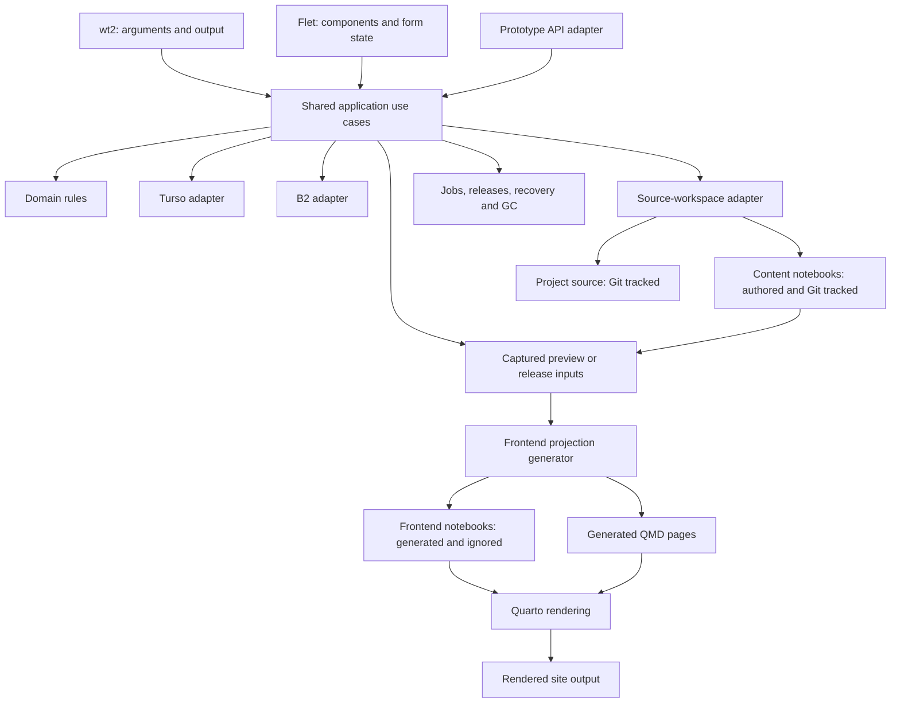

# wt2 and a declarative Flet CMS

[Plan index](README.md) · [Development stages](development-plan.md)

**Direction:** use Flet's declarative approach for the local CMS and build a
first-class CLI v2. **Recommended sequence:** implement each backend capability
through the CLI first, then expose it in Flet. Bring in a thin Flet screen early;
do not wait until the entire CLI is finished to discover interface constraints.

This work is a separate prototype: reverse engineer a v1 workflow, explain its
rules and problems, then implement and compare a deliberate v2 design. Adoption
is undecided. Prototype records, content copies, storage and output targets are
isolated from the working CMS.

## Feasibility and scope

Flet documents declarative components, state hooks and observable view state.
That is a plausible fit for editors, lists and dialogs. Framework support alone
does not prove that our specific interactions work; stage 1 includes a focused
prototype and a pinned-version compatibility report.
[Declarative model](https://flet.dev/docs/cookbook/declarative-vs-imperative/),
[declarative dialogs](https://flet.dev/docs/cookbook/declarative-dialogs/).

The CMS interface is rebuilt in Flet. Its current Jinja/HTMX implementation cannot
be reused directly, though domain rules and behavioral tests remain useful.
Preserve the white/charcoal/orange design, familiar workflows, keyboard access,
and unsaved-edit/conflict protections. The public Quarto site and notebook editor
workflow remain separate from the CMS interface.

Recommend a local Python-backed Flet application opened in the browser initially,
matching today's local browser workflow. Native desktop packaging can be a later
delivery choice. This is a recommendation, not a confirmed browser-versus-desktop
decision. A static browser-only runtime is not the initial architecture: notebook
access, credentials, provider adapters, and recovery run in local Python.
[Python-backed Flet web deployment](https://flet.dev/docs/publish/web/dynamic-website/).

## One application core, several interfaces

The CLI can operate with the Flet application closed. Flet calls typed use cases;
it does not shell out to CLI commands or parse terminal output. An HTTP adapter
exposes the same use cases where API compatibility is required. A mandatory
extra HTTP hop between local Python interfaces and the core is unnecessary initially.

Keep Flet imports/dependencies outside the headless core/CLI package boundary.
The CLI must not require a running GUI, browser session, or Flutter runtime.
CLI, API, UI and workers share validation, authorization, transactions, revision
checks, retention policy, and operation recovery.

Content notebooks and frontend notebooks are separate. CLI notebook edits target
the canonical authored sources. Builds generate frontend copies with the selected
CMS metadata and page wrappers, then render those copies. Generated notebooks
stay in ignored build stages and follow build GC; they never become a second
editable content authority. See [the notebook layers](architecture.md#content-notebooks-and-frontend-notebooks).

## What CLI v2 means

**The v2 executable is `wt2`, confirmed by you.** The existing `wt` remains the
current working interface. `wt2` is a separate prototype entry point with its own
documented commands and output contract, not an alias for `wt`. Once implemented,
project-local invocations use `.venv/bin/wt2` from `projects/watchtower2/`.
That executable is not created
by this design document.

Preserve domain features while designing useful v2 commands. Existing `wt`
examples describe the v1 baseline; they do not require identical v2 flags or JSON
shapes. Compare how each workflow is expressed in `wt` and `wt2` and keep the
prototype's command reference up to date. Existing scripts, root AGENTS.md and
current skills continue to describe v1. Any future change to those consumers
depends on an adoption decision. A familiar command may be retained where it fits,
without requiring a v1 compatibility layer.

| Area | CLI v2 contract |
| --- | --- |
| Discovery | Clear help, version/schema information, environment/workspace identity, examples, and context commands explaining reading paths and ownership. |
| Inputs | Typed arguments and structured patch/batch files; no ad hoc YAML edits or raw notebook JSON manipulation. |
| Output | Documented, versioned JSON for agents/scripts; readable text/table mode; stable IDs/revisions. Keep progress messages separate from JSON results. |
| Errors | Documented codes and exit statuses; actionable validation/conflict/pending-operation details; redacted credentials. |
| Writes | Expected revisions, operation identity, no automatic stale rebase, explicit environment selection, and coherent batches. |
| Long work | Start/status/log/wait and supported cancellation. Exiting a waiting command must not ambiguously undo a committed action or abandon unrecorded work. |
| Deletion | Direct object removal, unlink, eligible purge, policy inspection/editing and cleanup runs. Report owners, blockers, eligibility time and actual reclaimed bytes; revalidate on apply through the shared backend deletion service. |
| Diagnostics | Integrity audit, storage accounting, object ownership/version inspection, operation recovery, release inspection, and backup verification. |
| Automation | Noninteractive operation, pagination/filtering, bounded results, documented retry behavior, and no required GUI prompt. |
| Sources | Notebook cell operations, explicit execution, output conflicts, project registration, and filesystem safety. |

Propose a consistent JSON envelope with schema version, result data, applicable
revisions, and operation ID. Agree on output/error compatibility before changing
scripts. Command grammar, flags, and exit-code values are implementation-stage
decisions; this document introduces no executable commands.

While prototyping `wt2`, maintain a behavior-comparison ledger mapping current
commands/flags, JSON fields, API routes, revisions and error behavior to the new
use cases. Mark each preserved, intentionally changed, or deprecated with its
reason and prototype evidence. Verify headless installation separately from the Flet
dependency group, and reject incompatible database versions before writing.

### Capability order

1. Configuration/context and one Kanban transaction with revision conflicts.
2. Remote database behavior, operation receipts, and recovery inspection.
3. Attachments, shared ownership, B2 verification and downloads.
4. Storage accounting, GC dry-run/apply, backup protection and recovery.
5. Catalog/plans/notes/to-dos, courses, source operations, portfolio/profile/photos.
6. Preview/build, release export/inspection/retirement, fixture import/export and restore tools.

Every UI action mutating durable state should have a supported headless use case
and corresponding CLI coverage. The CLI need not imitate presentation gestures
such as opening a dialog or dragging a card.

## Declarative state and durable state

| State | Example | Authority |
| --- | --- | --- |
| Persisted application data | Card column, chapter title, attachment ownership | Application core backed by Turso/B2/source files. |
| Editor draft | Unsaved notes, selected upload, base revision | Flet form/session state until successful save. |
| Presentation state | Open dialog, selected tab, loading/error indicator | Flet component state. |

A component renders those states into controls. A user event calls a use case;
its result updates the saved snapshot and form state. Rendering itself does not
write to storage. UI observables are not the database and must not duplicate
domain rules or make independent provider writes.

Keep stable component identity for editors/cards. Refreshes and re-renders must
not reset a dirty form, forget its original revision, drop selected files, or
silently replace submitted data after a conflict. A delayed response must not
overwrite the editor for a different artifact. Keep operation IDs across transport
retries and guard against double submission.

Run network work asynchronously where supported and move blocking source/render
work to workers. Show status through the same durable operation records the CLI
inspects. Closing a dialog does not prove cancellation. A refresh never advances
publication or task status by itself.

Recommended initial editor contract: explicit saves, session-local drafts that
survive re-renders/modal closure, and a dirty-navigation warning. App/process
crash recovery of unsaved text is an open choice, not an implied guarantee. If
required, design bounded local draft recovery with expiry and explicit restore;
do not create persistent database history on every keystroke. Agree on this
behavior during the stage 1 prototype.

## Early Flet prototype: evidence required

Use disposable data to demonstrate:

- Controlled editor fields and notes/to-do dialogs retaining unsaved values
  through re-renders and validation failures.
- Two clients editing one card: stale save preserves submitted data and requires
  explicit reload/review.
- Kanban drag/move plus a keyboard-accessible Move control and detail navigation.
  [DragTarget reference](https://flet.dev/docs/controls/dragtarget/).
- Selection/upload, cancellation, exact-byte verification, and recovery on the
  intended browser/OS. Browser selection cannot assume a local file path; exercise
  the actual upload route and picker gesture requirements.
  [FilePicker reference](https://flet.dev/docs/services/filepicker/).
- Markdown, equations, links, code, clipboard/source opening, focus restoration,
  keyboard navigation and a screen-reader check using our actual content.
  [Markdown reference](https://flet.dev/docs/controls/markdown/),
  [accessibility guidance](https://flet.dev/docs/cookbook/accessibility/).
- A long job, lost connection, and completed operation after the view closes,
  with a responsive interface and discoverable outcome.

Keep upload staging and downloaded context files outside Flet's public assets
directory. Authorize downloads through ownership checks. Apply the existing
upload limits and lease/GC policy. Pin Flet and verify Python 3.14 support, local
HTTP/WebSocket restrictions, startup/shutdown, and browser behavior.

### Explicit parity adjustment

The old CMS's no-JavaScript HTML forms and native-select fallbacks are tied to
its rendering technology. Flet requires its client runtime; those mechanisms
are not carried over. You accepted this tradeoff in favor of richer components
and more readable declarative UI code. Rebuilding the CMS presentation and
replacing its HTML/no-JavaScript fallback are accepted interface changes.

Readability remains an implementation goal: use small reusable components,
explicit editor state, and thin event handlers calling the shared backend.

Translate P13/P16/P17/P19 into equivalent actions and accessibility requirements:
explicit Move controls, keyboard selection, preserved drafts, accessible dialogs,
and stable return navigation. An independent CLI provides headless operation;
it does not substitute for an accessible GUI. Recheck detail links and
back/forward navigation in the chosen Flet mode.

## Delivery sequence and why

| Approach | Assessment |
| --- | --- |
| Finish every CLI feature, then first try Flet | Gives a headless milestone, but discovers interface constraints late. |
| Build all CLI and UI surfaces simultaneously | Adds context switching before storage/failure semantics are clear. |
| CLI-led slices with early Flet integration | Recommended. Understand and verify a backend action, then prove the same action through the UI. |

Stage 1 includes the Flet feasibility prototype. Stage 2 delivers a real headless
CLI slice. By stage 3, wire one real Flet screen to that use case. Continue CLI
then Flet for each capability, with the CLI generally one slice ahead.

CLI v2 can reach a useful independent prototype milestone before the complete CMS.
Keep it on isolated v2 data while v1 remains the working system. Evaluate the
results before deciding whether to continue experimenting, reuse selected
improvements, or separately plan adoption. No cutover is scheduled by this plan.
