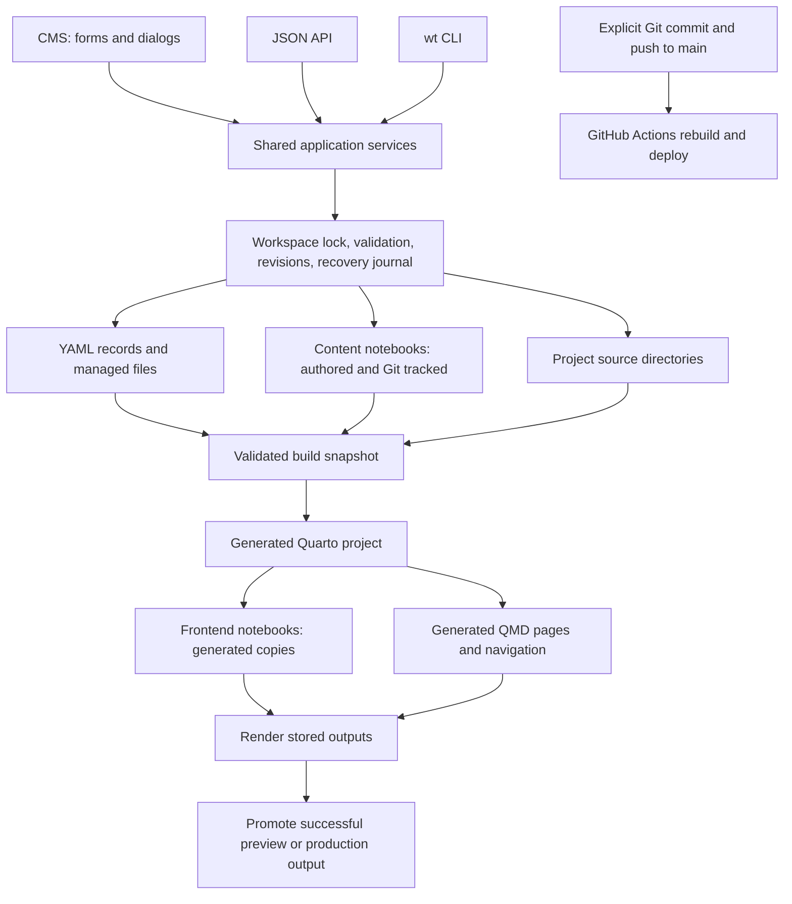

# 1. Understand the current CMS

[Plan index](README.md) · Next: [target architecture](architecture.md)

This is a source-based tour of v1, checked on 2026-10-15. It includes the local
build-retention changes already developed in this checkout; those changes are
separate from implementing v2. Earlier design notes under `docs/` are historical
context, not a complete description of current behavior.

## The system in one picture

The CMS is not a database-backed web application today. Its database is
effectively a set of YAML files and files on disk, coordinated by custom Python
services. Git records whatever you later commit; a CMS save does not itself
create a Git commit. There is no application SQLite database in this path.

### Where information lives

| Information | Current authority |
| --- | --- |
| Identity, lifecycle, visibility, relationships, notes, to-dos, attachment links | `backend/data/catalog.yaml` |
| Course outline, home, chapter summaries and planning inputs | `backend/data/courses/` |
| Portfolio, profile/résumé, photo records | Their YAML files in `backend/data/` |
| Cards, task numbers, card notes/checklists | `backend/data/kanban.yaml` |
| Context file bytes | `backend/attachments/<sha256>` |
| Uploaded public images | `backend/assets/` |
| Authored bodies, outputs, cell options, notebook-relative sidecars | `content/notebooks/` |
| Project source | `projects/`, or an explicitly referenced historical project |
| Templates, theme, repository settings | `frontend/` |
| Locks, journals, build records/logs | Ignored `backend/runtime/` |
| Generated render projects and sites | Ignored `frontend/generated/` |

Content notebooks are the authored authority. Frontend notebooks are generated
copies under a build stage's `nb/` routes; the generator adds document metadata
and wrappers and rewrites links there before Quarto renders them. These copies
are ignored, disposable build inputs. Generated edits never flow back to source.

“Private” and “CMS-only” describe site visibility. They do not make a file
confidential if it is committed to a public repository.

## Walk through an ordinary save

Example: edit a started chapter's internal notes and checklist.

1. The CMS reads its context and revision through shared services. The editor
   retains that revision while you work.
2. The submitted form reaches the CMS adapter. API clients submit a revision in
   `If-Match`; CLI clients can pass `--expected-revision`.
3. `ContentService._mutate` enters the workspace gate, captures current inputs,
   and rejects a stale revision. A stale write is never silently retried.
4. The service constructs candidate metadata, checks lifecycle/plan rules,
   computes last-owner attachment cleanup, and validates the proposed workspace.
5. `WorkspaceStore.commit` records recoverable preimages and proposed bytes,
   then installs the coordinated changes. A crash is resolved from the journal;
   divergent external edits block recovery and preserve the versions.
6. The response contains the new revision. The notebook body and publication
   status have not changed. Git sees a YAML diff if that YAML is tracked.

The gate coordinates supported clients. An editor saving directly to disk does
not participate in that lock; v1 still has a small check-to-replace race for
uncoordinated filesystem writes. Revisions describe input bytes, not Git commits.

### Three actions with different consequences

| Action | Consequence |
| --- | --- |
| Move a card | Rewrite the board, preserve its permanent `card#N`, return a board revision. No artifact publication change. |
| Start a plan | Create source once, consume supported brief fields, set Draft/private, and coordinate related metadata/scaffold changes. |
| Build preview | Snapshot saved inputs, generate copies and navigation, render stored outputs, promote only successful output. No kernel execution or deployment. |

There is a useful distinction already present in v1: notebooks hold accepted
content; entity notes hold unfinished content decisions; linked cards hold
scoped execution context. V2 must preserve that distinction.

## Why storage grows

**Git history:** repeated state revisions and new binary versions remain in
history after deletion from the working tree. Identical file bytes share Git
objects, so moving an unchanged attachment into an archive does not duplicate
its entire payload. Repeatedly changing large files is a larger problem than
their directory names.

**Managed archives:** removing the last context-file owner moves bytes and
ownership metadata to `archive/deleted/<operation>/`. Starting content also
preserves seed inputs/preimages under `archive/starter-seeds/`. Those mechanisms
preserve recoverability but do not impose a complete automatic retention policy.
Image replacement likewise does not have comprehensive reachability cleanup.

**Local build disk:** previous renders accumulated complete generated projects.
The build cleanup developed in this checkout now protects the current and
fallback sites, retains recent diagnostics, and removes old stages on builds.
Those ignored directories are a disk problem distinct from Git history.

**Recovery and scratch:** pending journals and execution-conflict notebooks need
explicit resolution. They cannot safely be treated as anonymous temporary files.

The storage review also found context files present locally but absent from the
committed attachment tree, despite committed metadata referring to them. A clean
clone is therefore insufficient as a complete reference fixture. Inventory the
working workspace read-only, including untracked managed files, before making
verified copies for isolated experiments. Do not mutate it to seed the prototype.

## Guided source reading

Start with the first six rows. Read one action through them before exploring
special cases; there is no need to read every file in a single sitting.

| Order | Source | What to follow |
| --- | --- | --- |
| 1 | [Models](../../../src/watchtower/models/__init__.py) | Artifact, course, card, attachment, photo; list fields and invariants. |
| 2 | [API application](../../../src/watchtower/api/app.py) | App construction, revision requirements, an update route. |
| 3 | [CMS adapter](../../../src/watchtower/api/cms.py), [authoring forms](../../../src/watchtower/api/authoring.py) | Form parsing, conflict input preservation, action dispatch. |
| 4 | [Content service](../../../src/watchtower/services/content.py) | `snapshot`, `_mutate`, `start`, and validation of a complete candidate. |
| 5 | [Workspace store](../../../src/watchtower/services/workspace.py) | Lock, byte revisions, durable journal, commit and recovery. |
| 6 | [One service test](../../../tests/test_content_service.py) | Arrange input, perform a save, inspect the resulting contract. |
| 7 | [Kanban](../../../src/watchtower/services/kanban.py), [attachments](../../../src/watchtower/services/attachments.py) | Board-scoped conflicts, ownership, shared bytes, last-owner cleanup. |
| 8 | [Notebook service](../../../src/watchtower/services/notebooks.py), [execution](../../../src/watchtower/execute.py) | Exact source revisions, explicit execution, conflicting output saves. |
| 9 | [Build service](../../../src/watchtower/services/build.py) | Eligibility filtering, immutable stages, failure preservation, retention. |
| 10 | [Publish workflow](../../../.github/workflows/publish.yml), [dev launcher](../../../scripts/dev.py) | Local authoring versus committed production builds. |

For an interactive walkthrough, first run `.venv/bin/wt map`, then inspect
`.venv/bin/wt context <an-existing-id>` and `.venv/bin/wt kanban ls`. These reads
expose the same concepts that the UI uses. Do not start by inspecting raw notebook
JSON or manually editing managed YAML.

## Feature parity checklist

All rows start **planned/unverified for v2**. Existing tests are a behavioral
reference, not evidence that a new backend already preserves the behavior. The
implementation should add an evidence link and date for each completed row.
Stage numbers refer to the [development plan](development-plan.md).

This is the v1 behavioral baseline. The Flet direction changes interface mechanisms
in P13/P16/P17/P19, including the old HTML/no-JavaScript fallback. Preserve their
functional intent through explicit controls, keyboard access and draft/conflict
handling; verify [the accepted parity adjustment](cli-v2-and-flet.md#explicit-parity-adjustment)
when evaluating the prototype. Existing HTML/JavaScript tests inform requirements but do not
directly verify Flet controls.

| ID | Required behavior | Existing evidence / source | Target stage |
| --- | --- | --- | --- |
| P01 | Stable derived IDs, preserved routes, tags and ordered exact-ID relations; permanent retired ID/source reservations; dates default only at creation in site timezone; archives searched deliberately. | [Models](../../../src/watchtower/models/__init__.py), [content tests](../../../tests/test_content_service.py) | 6 |
| P02 | Private Planned creation, optional/partial/empty briefs, no notebook until Start; no implicit generation. Planned non-course notes/to-dos empty; planned courses may hold them. | [Plan authority](../../../tests/test_plan_authority.py), [starters](../../../tests/test_draft_starters.py) | 6 |
| P03 | Start exactly once; Draft/private; supported brief sections seeded and consumed; course home initialization; portfolio code scaffold/registration; existing source collision refused. Preserve seed provenance outside routine Git state. | [Starter seeds](../../../tests/test_starter_seeds.py), [projects](../../../tests/test_projects.py) | 6 |
| P04 | Publish requires content and makes public; draft preserves source/visibility; parent course rules; no implicit sibling publishing; empty scaffold repair rules. | [Publishing](../../../tests/test_publishing_workflow.py), [domain acceptance](../../../tests/test_domain_acceptance.py) | 6 |
| P05 | Notebook reads/diff/cell operations/tags/options/outputs/kernels and explicit execution; exact byte revisions; execution conflicts preserved; stable public plotting imports. No execution on save/render. | [Notebook](../../../tests/test_notebook.py), [execute](../../../tests/test_execute.py), [outputs](../../../tests/test_outputs.py) | 6 |
| P06 | Persistent Markdown entity notes and ordered to-dos, separate from card memory; published editing allowed; consumed plan hidden/frozen; notes excluded from public projections. | [Notes](../../../tests/test_authoring_notes.py), [to-dos](../../../tests/test_internal_todos.py) | 6 |
| P07 | Ordered sections/chapters, rename/reorder/transfer within course, exact membership, at least one section, remove empty sections only; coherent catalog/outline/summary updates. | [Course navigation](../../../tests/test_cms_course_navigation.py), [content tests](../../../tests/test_content_service.py) | 6 |
| P08 | CMS course home fields and lists; generated chapter table and short navigation title; eligible links; missing-summary behavior differs between preview and production. | [Course homes](../../../tests/test_course_homes.py), [knowledge](../../../tests/test_knowledge.py) | 6–7 |
| P09 | Portfolio listing abstract/image/caption, separate notebook body, active/archived code references, project directory validation, ordered related links; draft diagnostics; no planned page/card. | [Projects](../../../tests/test_projects.py), [build](../../../tests/test_build.py), [authoring](../../../tests/test_cms_authoring.py) | 6–7 |
| P10 | Structured profile, contact, employment, education, skills, projects; homepage and résumé generation preserve ordering and facts. | [API](../../../tests/test_api.py), [build](../../../tests/test_build.py) | 6–7 |
| P11 | Per-photo heading/caption/order/width/lifecycle; draft no-image placeholder; published image requirement; uploads travel with rows; derived gallery state, no collection publication switch. | [Authoring](../../../tests/test_cms_authoring.py), [build](../../../tests/test_build.py) | 6–7 |
| P12 | Four-column Kanban, immutable IDs/nonreused `card#N`, search, linked context, card notes/to-dos, summary task deduplication; board token independent of unrelated content. Movement never changes publication. | [Kanban](../../../tests/test_kanban.py), [summary tasks](../../../tests/test_cms_summary_tasks.py) | 2–3, 6 |
| P13 | Background drag/move, unsaved-move blocking, failed-move restoration and reload requirement; full card dialog; native Move and direct detail URLs. | [Interactions](../../../tests/test_cms_interactions.py), [JavaScript](../../../tests/test_cms_javascript.py) | 6 |
| P14 | Shared context bytes, per-owner filename/type/size, task-to-entity link promotion, active-owner downloads, checksums and image validation; 20 MB/file, 20 files/100 MB request; excluded from public builds. | [Attachments](../../../tests/test_context_attachments.py) | 4–5 |
| P15 | Public-image upload and metadata save coherent; keep an existing image for an empty upload; preserve supported types/limits and existing public URLs through projection. | [Images](../../../src/watchtower/services/images.py), [authoring](../../../tests/test_cms_authoring.py) | 4, 6–7 |
| P16 | Search/select relationships by registered ID, ordered deduplication, native fallback, unknown-ID rejection, submitted/missing selections preserved on conflict for repair. | [Authoring](../../../tests/test_cms_authoring.py), [interactions](../../../tests/test_cms_interactions.py) | 6 |
| P17 | Current UI palette/layout; Basics/Page/Plan editing, notes/to-do dialogs preserving unsaved fields/uploads, Markdown/math plan reader, native fallbacks, focus/validation behavior. | [Planning](../../../tests/test_cms_planning.py), [plan view](../../../tests/test_cms_plan_view.py), [interactions](../../../tests/test_cms_interactions.py) | 6 |
| P18 | Planned context versus started source links; existing-path VS Code links, copy path/create task; publish includes pending form metadata/upload atomically; other lifecycle actions respect dirty forms. | [Workflow matrix](../../../tests/test_cms_workflow_matrix.py), [authoring](../../../tests/test_cms_authoring.py) | 6 |
| P19 | Search/filter/pagination and chapter return destination survive saves/conflicts/actions; course disclosures, résumé sections and photo/portfolio editing remain usable without JavaScript. | [Course navigation](../../../tests/test_cms_course_navigation.py), [interactions](../../../tests/test_cms_interactions.py) | 6 |
| P20 | Expected-revision API/CLI writes, no automatic stale retries; coherent batches/structured repairs; explicit malformed-data repair with preserved originals. Keep CLI command coverage and documented compatibility. | [API](../../../tests/test_api.py), [content](../../../tests/test_content_service.py), [CLI sources](../../../src/watchtower/content_cli.py) | 2–3, 6 |
| P21 | Reviewed deletion/cascade, incoming link and course-outline repair, source reservations; do not delete historical code dependencies or the gallery record; shared objects survive. Undo becomes explicitly time bounded. | [Deletion](../../../tests/test_deletion.py), [attachments](../../../tests/test_context_attachments.py) | 5–6 |
| P22 | Planned exclusion; parent course suppression; preview drafts/private content and shared diagnostics; production public/published only; H1/title rules; related links and public listing summaries. No internal data leakage. | [Build](../../../tests/test_build.py), [knowledge](../../../tests/test_knowledge.py) | 7 |
| P23 | Asynchronous build status/logs, last-successful promotion/fallback, bounded stages/history, explicit dev ports and tied process shutdown; local authoring does not deploy. | [Build](../../../tests/test_build.py), [dev launcher](../../../scripts/dev.py) | 7 |
| P24 | Vault secrets, localhost host/origin protection, safe paths and downloads, file limits; notebook execution remains explicit. Hosted authentication is a separate decision if hosting is selected. | [API](../../../tests/test_api.py), [workspace store](../../../src/watchtower/services/workspace.py) | 1, 3–7 |
| P25 | Import/register/project scaffolding; layout/course-home/starter migration compatibility; preserve legacy/unknown input during import, permanent references, and archived code dependencies. | [Content service](../../../src/watchtower/services/content.py), [projects](../../../tests/test_projects.py), [migration review](../../../docs/content-system-migration-review.md) | 6, 8 |

During stage 0, expand a row when a walkthrough reveals another observable rule.
Do not treat this table as permission to simplify behavior silently.
