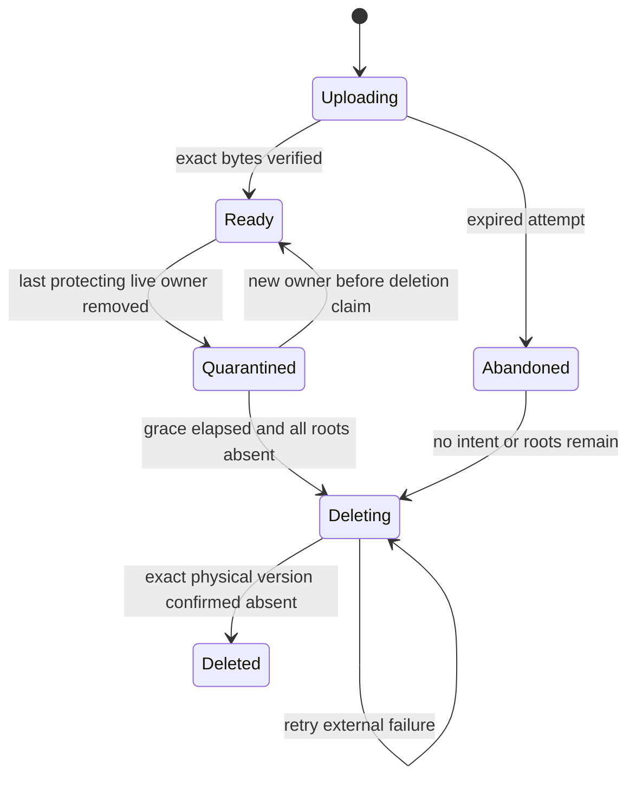

# 3. Retention and garbage collection

[Plan index](README.md) · Next: [development stages](development-plan.md)

**Proposed defaults.** Review these durations before enabling deletion against
live data. Moving state into a database or B2 does not automatically bound it.
The policy must cover database rows, every object version, local disk, and
recoverable work.

These policies govern isolated prototype resources. V1 storage, live B2 objects,
and the current website are outside prototype cleanup. Adoption and any import
of real historical data are future decisions.

## Backend ownership and straightforward deletion

The backend owns object deletion and garbage collection. CLI v2, Flet, periodic
tasks in the active backend, and last-owner cleanup call the same deletion service.
They share
eligibility checks, policy evaluation, transactional claims, physical deletion,
retries and reporting. UI components and command handlers do not delete B2 keys
or local build directories independently.

### Supported deletion boundary

Delete managed objects through CLI v2, Flet, the shared API, or backend policy
workers. This covers attachments, uploaded images, entity/card records, retained
undo payloads, release pins, and generated build/cache storage. Do not delete
their files/keys through Explorer, VS Code, the shell, SQL, or the B2 console as
an ordinary prototype workflow. Test legacy-archive cleanup against copied
fixtures only; the prototype never sweeps the current `archive/deleted/` tree.

Content notebook bodies and code files remain editable in VS Code/Jupyter and
other editors. Retiring a registered notebook/entity still uses the backend so
its records, links, ownership and source reservations stay coherent. Removing a
referenced project directory requires resolving its active dependencies first.
Ordinary unmanaged scratch files remain outside this object-deletion contract.

This is a supported-workflow boundary, not an OS-level guarantee that a user with
filesystem/admin access cannot bypass it. Direct removal of a referenced file or
object is an integrity fault. Detect and report affected owners/releases; restore
the missing version or perform an explicit supported repair/retirement. Never
interpret absence as a deletion request or silently discard its database links.
Backend-owned cleanup may remove an unleased, disposable cache entry normally;
that does not retire its authoritative object.

Expose clear actions with distinct outcomes:

| Action | User-visible result |
| --- | --- |
| Remove a file from an artifact/card | Remove that ownership link immediately. Shared owners keep working; the last unlink schedules collection under the applicable policy. |
| Delete an object | Show its owners and retention reasons, then remove the selected references or request deletion of an unowned object. Never silently detach other owners. Required images/dependencies must be replaced or handled through a valid domain change. |
| Permanently delete an eligible object | Claim and delete the exact physical version, then verify absence. An explicit purge may waive ordinary quarantine grace, but cannot bypass active ownership, retained undo, release/backup pins, or in-flight operations. |
| Run a cleanup policy | Select qualifying objects and submit them through that same deletion pipeline. Return per-object results and reclaimed bytes. |

Deletion requests return the operation ID, affected owners, status, blocking
reasons, and the next eligibility time when known. Distinguish **reference
removed**, **scheduled**, **blocked by retention**, **deleting**, **deleted**, and
**failed/retryable**. A reference disappearing from the CMS does not mean storage
bytes have already been reclaimed. CLI output and Flet must make this clear.

The ordinary path should require a straightforward action, with the backend
handling bookkeeping and recovery. A retained object should have an actionable
explanation such as “used by card#12” or “protected by backup until this date.”
Reattaching a quarantined object can cancel its scheduled collection before a
physical deletion claim; once physical deletion starts, use a different verified
version for new ownership.

## Configurable policies

Policies are versioned backend records, inspectable through CLI v2 and Flet.
Each policy defines its object category/scope, qualifying state, age or count
threshold, grace period, enabled status, schedule, and per-run limits on objects
and bytes. Start with named policies for abandoned uploads, unreferenced blobs,
deleted-record undo, expired release/backup retention, build stages, and caches.

Use typed policy fields and supported selectors, rather than arbitrary SQL or
shell scripts. Preview a policy change against current inventory: show newly
eligible objects, retained objects and reasons, and estimated bytes. Saving a
policy uses expected revisions; applying it always rechecks current roots.

Policies control when an object becomes eligible. They cannot override active
references or protected recovery/release guarantees. Expiring a backup or
retiring a release is a supported operation that removes its own pins before
object collection can proceed. The initial durations below are defaults, not
hard-coded behavior scattered through UI callbacks.

## The deletion rule

An object is collectible only when no active owner, retained undo record,
exported release, unexpired backup, or valid pending operation protects it.
Treat these references as roots. A cached reference count may speed reporting;
it cannot be the sole authority for deletion.

Public lifecycle is not a retention rule. Drafts and private work remain live
data. Moving a card to Done does not prove its results were preserved elsewhere.
Historical code referenced by active portfolio entries remains a source dependency.

## Retention table

All ages are measured from the listed transition, using recorded UTC timestamps.
Policies apply within an environment/workspace, with a stored policy version.

| Data | Proposed retention | What permits removal |
| --- | --- | --- |
| Active records and their owned files | Indefinite while active | Explicit removal through supported use cases. No age-based purge. |
| Unfinished upload/session | 24 hours after last activity and lease expiry | No valid upload intent/worker; cancel multipart work and reconcile versions. |
| Verified upload never attached; duplicate upload attempt | 24 hours after completion | No owner, pending finalization, release, backup, or active lease. |
| Blob losing its last owner | Quarantine for at least 7 days | Every root absent, supported restore window protected, then a transactional deletion claim. |
| Deleted entity/card undo payload | 30 days after deletion | Undo period elapsed, references reconciled, no longer pinned by backups/releases. Notebook undo bytes stored outside tracked Git archives. |
| Completed cards | Suggest archive after 30 days in Done | Archive stays searchable. Suggest purge after 90 days in Done only after explicit result-handoff confirmation; otherwise flag for review and retain. |
| Permanent ID/source reservations and card number high-water mark | Indefinite | Never reuse. Keep small identity records without old payloads. |
| Unexported release preparation | 24 hours after abandoned lease | No exported manifest or successful publication receipt. |
| Exported release with publication status unresolved | Until reconciled | Never expire an export that may already be committed/deployed based on age alone. Flag after 7 days; cap outstanding exports to prevent silent accumulation. |
| Confirmed published release | Protect current production, the previous 3 successful releases, all releases under 90 days old, and named pins | Outside that set, record retirement after verifying deployment/rollback/backup roots. Enable policy-driven retirement only after the supported rebuild promise is accepted. |
| Application backup snapshots | Start with 30 days | A completed replacement backup exists; expiry policy permits removal; delete its object pins only when its restore promise expires. Confirm provider PITR separately. |
| Completed source-operation staging | 7 days after completion | Final state verified; no unresolved recovery or undo dependency. |
| Pending/conflicted source operations or execution results | Until resolved | Report age and require explicit resolution; never discard divergent authored bytes by TTL. |
| Audit events and operation detail | 90 days | No unresolved operation depends on them. Keep concise events, not full workspace copies per save. |
| Request/idempotency receipts | At least the documented retry window; propose 7 days | Requests outside that window are rejected as expired, not replayed as new operations. |
| Local successful build projects | Current and one successful fallback per mode | No active renderer/export lease; exclude protected output targets. |
| Local failed projects | Latest failure per mode, up to 7 days | Not active or needed for an unresolved operation. |
| Local build records/logs | Latest 20 completed per mode plus retained-output records; cap log tail at 64 KiB/record | No active job or retained output depends on the record; full debug logs expire after 7 days. |
| CI staging, deployment artifacts and diagnostics | Staging ends with the job; configure bounded workflow-artifact/log retention | Keep hosted-site lifetime separate from transient artifact retention. Verify deployment and rollback behavior before enabling cleanup; durable rebuild roots remain in the release registry. |
| Standalone generated export project | Until export finishes and lease closes | Durable requested PDF/export copied to its destination before stage removal. |
| Download/render cache | LRU, proposed 1 GiB cap | No active download/build lease; cached bytes can be fetched again from a verified origin. |
| App-owned Flet upload staging and generated packaging output | Upload staging follows the 24-hour session policy; packaging stages follow job leases and build retention | Keep outside public assets and tracked Git. Never sweep shared system/Flet/Flutter dependency caches as if they were app-owned files. |

“At least 7 days” does not override backup safety. A database restored to an
earlier supported point must still find its referenced object versions. Backup
manifests pin those exact versions for their full lifetime. Where a provider PITR
window lacks exact object manifests, keep a conservative time-based protection
covering that entire window plus a safety margin. Enable deletion only after
proving this rule with an actual restore.

The Done-card rule adds explicit result-handoff confirmation; it must be designed
and explained in the UI/CLI before automated purge is enabled. Until then, report
candidates without purging cards. Existing historical archives are outside
automatic GC until individually classified. Do not sweep all of `archive/`.

Release retention is a deliberate tradeoff. Keeping every historical release
rebuildable pins its asset versions forever. The proposed bounded rebuild set
above allows retirement of older assets; old Git manifests remain as history but
are no longer promised to build. Retirement must be a recorded application
operation, never a bucket-wide age rule. If you want every old commit rebuildable,
choose indefinite release pins and treat that growth as retained content. Resolve
this decision in stage 7. Unresolved export status is operational work to reconcile,
not a reason to silently remove possibly deployed assets.

## Safe object lifecycle

Other roots can protect a quarantined object after its timer expires. That is
retention, not a leak. Report its protecting reason.

### Collector algorithm

1. Read candidates and produce an audit report: logical ID, exact physical
   key/version, bytes, age, roots, policy, and reason. Listing a B2 object alone
   is not authorization to delete it.
2. In a transaction, recheck all root tables and leases. Conditionally claim an
   eligible physical version as Deleting with a unique claim/generation.
3. New links cannot attach to a Deleting version. They either wait for resolution
   or create/reuse a different verified physical version. A new upload attempt
   has a different physical key, even for identical bytes.
4. Delete only the claimed B2 version. Retry safely if a request or response is
   lost. Verify absence, then record a bounded deletion receipt. An error remains
   a visible retryable state; it is not reported as reclaimed space.
5. Reconcile database inventories against object versions periodically. Classify
   unknown versions using upload intents, backups, and a grace period before
   making deletion candidates. Missing live objects are incidents to restore,
   not references to silently erase.

An attach transaction racing a deletion claim must have exactly one winner.
Multiple workers may discover the same candidate, but only a valid claim can
finalize it. Unique physical identities make a paused worker's old deletion
harmless to a later replacement. Never reuse a physical upload key for new bytes.

B2 preserves versions by default. A delete without `versionId` creates a marker;
deleting a specific version permanently removes that version. The implementation
must account for old versions and markers, rather than equating a successful
key-level delete with reclaimed storage.
[B2 deletion semantics](https://www.backblaze.com/apidocs/s3-delete-object),
[B2 lifecycle rules](https://www.backblaze.com/docs/cloud-storage-lifecycle-rules).

Use lifecycle rules for genuinely temporary prefixes, unfinished multipart
uploads, and carefully classified remnants. Do not apply a broad age-based
expiration to active object prefixes. Enforce ownership in Turso; the design
does not rely on unsupported object tags.

## Local build cleanup

Keep the v1 improvement that cleans build stages on every build and preserves
successful output through failures. V2 adds explicit leases for renderers and
standalone exports, so a slow PDF export is protected by ownership rather than a
fixed one-hour guess.

A stage includes generated frontend notebook copies, generated QMD/navigation,
hydrated assets and rendered output. They share the stage's lease and retention.
Canonical content notebooks are outside this cleanup scope; deleting a generated
copy never deletes or changes its authored source.

Use an exclusive local render/cleanup gate, validated immediate-child stage IDs,
and no symlink traversal. Clean before allocating a large stage and after the
job finishes. Periodic/startup cleanup also handles an application that is not
built again. A cleanup error is visible and retryable; it does not convert a
successful render into a failure.

Queued/running jobs do not live forever because of their status string. Workers
renew leases; after expiry, a reconciler establishes that work is abandoned and
records interruption before cleanup. Lease timing is a provider-spike decision;
test paused workers, long renders, and lock ownership before choosing values.

## Scheduling, accounting, and backups

Run local and B2 reconciliation/cleanup at backend startup, after relevant
operations/builds, periodically during an active session, and on explicit CLI/CMS
request. The operating assumption is no authoring activity while the laptop is
closed; no external scheduler or always-on GC service is required.

Policy ages determine eligibility, not an exact deletion deadline. If a grace
period expires while Watchtower is inactive, the object can remain until the next
session. On startup/resume, reconcile any unfinished operations and perform bounded
catch-up with per-run object/byte limits. Keep the existing lease/root checks;
inactivity is not permission to delete uncertain work. CLI-triggered cleanup works
without starting Flet. Provider-managed temporary artifact expiry remains separate
from running our own GC worker.

Every run reports candidate, protected, deleted, failed, and retryable counts and
bytes, with reason codes and elapsed time. A storage view should distinguish
active data, release/backup retention, quarantine, abandoned attempts, cache, and
unresolved operations. Track oldest overdue candidate, growth rate, duplicate
physical versions, failed deletes, and missing-object checks. Alert thresholds
are configuration; quotas should block new allocation before deleting live work.

Dry-run and apply share candidate logic. Apply rechecks current roots, so an old
report is never a permanent deletion permit. If the database, ownership data, or
backup protection inventory is unavailable or inconsistent, stop physical
deletion and report the fault.

Backups carry immutable manifests of required versions outside the restored live
database. Protect those roots during backup creation before GC can run against
them. Restore runs in maintenance mode with GC stopped, validates every required
object, replaces worker generations, and reconciles before writes or deletion
resume. See the [restore procedure](migration-and-operations.md#backup-and-restore).

## Required failure demonstrations

Before live deletion is enabled, demonstrate:

- Attach versus last-owner removal/deletion claim; shared entity/card ownership.
- Duplicate upload, timeout after upload, and failed metadata finalization.
- Worker death before delete, after physical delete, and before database receipt.
- A paused old worker encountering a replacement with the same content digest.
- Release/backup/undo roots protecting bytes after live references disappear.
- Stale leases, two collectors, provider outage, missing object, and corrupt inventory.
- Restore to the oldest promised recovery point with byte-for-byte object checks.
- Repeated create/delete/build cycles returning to the declared retained set,
  with bounded operational rows and caches. Live data growth remains legitimate.
