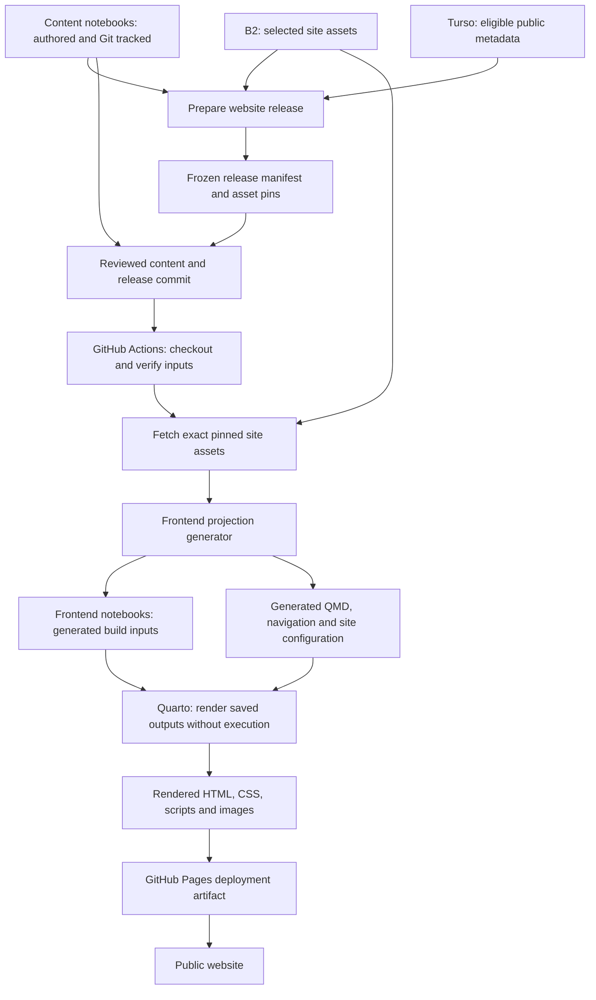

# Website deployment

[Plan index](README.md) · [Architecture](architecture.md)

**Recommendation:** build the website from generated **frontend notebooks** and
other generated Quarto pages. Keep **content notebooks** as the canonical authored
files. Deploy rendered HTML/assets to GitHub Pages using an Actions artifact,
with no generated notebooks or rendered site commits in Git.

This is the proposed v2 deployment path. The current
[publish workflow](../../../.github/workflows/publish.yml) still builds committed
v1 inputs and publishes through the existing `gh-pages` branch. No workflow or
hosting configuration has been changed by this plan.

V2 is a separate prototype. Demonstrate this path with isolated data, test
credentials, output directories and an optional disposable publishing target.
“Production mode” below means the prototype's public-only release mode, not the
current live website. Adoption and real publishing-source changes are future
decisions.

## The complete path



There are two distinct builds: generating the frontend project from captured
content/metadata/assets, and rendering that project into the website. Quarto
consumes frontend notebook copies, never writes metadata into content notebooks,
and does not run their kernels. Explicitly disable execution in generated
configuration. Quarto documents rendering stored notebook outputs without
execution. [Quarto Python/notebook rendering](https://quarto.org/docs/computations/python.html).

Some site pages, including course homes, listings and the gallery, are generated
QMD/templates rather than frontend notebooks. They travel through the same
release, rendering, and deployment path.

## 1. Author and preview locally

### Merging, releasing, and deploying are separate

| Action | V2 effect |
| --- | --- |
| Merge ordinary code/content changes to `main` | Run validation/checks. Do not create a release manifest or deploy the website automatically. |
| Prepare a website release in CLI/Flet | Freeze public metadata, capture content/configuration hashes, pin assets, and export a reviewable manifest. |
| Merge an approved new release manifest with matching inputs | Trigger the production build and deployment for that exact commit. |
| Redeploy/roll back to an existing release | Explicitly select its recorded commit and manifest digest; verify that the release remains retained and eligible. |

The existing v1 workflow still deploys on pushes to `main`; stage 7 demonstrates
a release-specific trigger in a separate prototype workflow. Ordinary checks and deployment are separate jobs
with separate conditions. Editing the application, a notebook, or CMS data does
not automatically create a new publication snapshot.

Edit content notebooks and explicitly run code when needed. Save metadata in
Turso and managed assets in B2 through the CMS/CLI. Preview captures saved inputs,
generates frontend notebooks and other pages in an ignored stage, then renders
them. Draft/private preview rules continue to apply.

A save or a local preview is not a deployment. Content lifecycle Published means
eligible for a public release; the deployed release ID separately identifies
what is actually live.

## 2. Prepare a frozen production release

Use the same backend action from CLI v2 or Flet to select the complete eligible
public dependency set. Validate source readiness, parent/course rules, links,
routes and assets. Capture allowlisted public metadata from Turso, record content
notebook/sidecar/configuration hashes, and pin the exact selected B2 versions.

Export a small versioned manifest for review and commit it with the matching
content notebook changes. Internal notes, task cards, plans and context
attachments are excluded. A production-mode local preview must use this same
frozen manifest so reviewing drafts cannot accidentally substitute for reviewing
the production release.

The manifest is a deliberate publication record in Git. Generated frontend
notebooks, downloaded assets and rendered output are ignored. Ordinary metadata
saves do not continually export new manifests into the repository.

## 3. Build frontend notebooks in CI

On an approved release commit or explicit deployment request:

1. Check out the selected commit and install the pinned publishing toolchain.
2. Read the committed manifest and verify every selected content/configuration
   hash. Fetch and verify the exact B2 site-asset versions using read-only access.
3. Generate an isolated frontend project from those captured inputs. Apply
   metadata, wrappers, link projections and navigation to generated copies.
4. Render frontend notebooks and generated QMD with execution disabled.
5. Validate the output and package only the rendered public site for deployment.

CI does not query live Turso, require the local CMS to be open, or publish its
latest mutable state. It can regenerate frontend notebooks from the selected
release. Keeping every generated notebook in B2 is unnecessary by default; a
debug/export bundle can be retained deliberately if useful, with its own policy.

Published releases must record the manifest digest, source commit, toolchain
identity, job outcome and deployment receipt. Verify projection reproducibility
under that toolchain; byte-identical rendered HTML across arbitrary toolchain
versions is not assumed.

Bind a release to the commit where its manifest and captured inputs match. If
later merges change content notebooks or templates, rebuild the old release
from its recorded commit, not from current `main` with the old manifest. Ordinary
CI checks must not mistake this expected divergence for a corrupt old release.
The first deployment validates its selected commit; retries reuse the same
release identity rather than creating fresh asset pins each time.

## CI authentication

The initial setup uses scoped provider credentials injected from GitHub Actions
environment secrets. Keep endpoint/region/bucket configuration in Actions
variables. The production website build receives only its B2 download credential;
it receives no Turso token and no upload/deletion credential.

| Process | Turso access | B2 access | Credential location |
| --- | --- | --- | --- |
| Local CLI/Flet backend | Database URL and database auth token for authoring operations | Scoped application credentials for managed reads/uploads | Existing OS-keyring vault; nonsecret settings in local configuration. |
| Website build in Actions | None; read the committed public release manifest | Read-only key limited to the site-input bucket/prefix, including retained versions needed by releases | Dedicated Actions environment secrets. |
| Local backend GC task | Access needed to inspect roots and transactionally claim/finalize deletions | Separate scoped list/read/delete credentials for managed objects; backup storage remains separately protected | OS-keyring vault. Runs during active use; no external scheduler is required. |
| Pages deployment job | None | None; deploy the rendered artifact | GitHub workflow permissions/identity for Pages, separate from B2 credentials. |

For B2's S3-compatible API, the application `keyID` maps to
`AWS_ACCESS_KEY_ID` and `applicationKey` maps to `AWS_SECRET_ACCESS_KEY`.
Create a dedicated CI application key restricted to site inputs and read-only
capabilities. B2 supports bucket/prefix restrictions and expiring application
keys. Verify exact-version downloads with that restricted key in stage 1.
[B2 credential mapping](https://www.backblaze.com/docs/en/cloud-storage-get-started-with-a-backblaze-integration),
[B2 application-key scopes](https://www.backblaze.com/docs/cloud-storage-application-keys).

Illustrative environment mapping for the future hydration step, not an installed
workflow or final Watchtower configuration schema:

```yaml
env:
  AWS_ACCESS_KEY_ID: ${{ secrets.B2_CI_KEY_ID }}
  AWS_SECRET_ACCESS_KEY: ${{ secrets.B2_CI_APPLICATION_KEY }}
  B2_ENDPOINT: ${{ vars.B2_ENDPOINT }}
  B2_REGION: ${{ vars.B2_REGION }}
  B2_BUCKET: ${{ vars.B2_SITE_BUCKET }}
```

GitHub injects referenced secrets at job runtime; the workflow stores references,
not credential values. Scope the hydration job to the intended environment and
release branches, and expose secrets only to the steps that need them. Untrusted
pull-request validation should run without production secrets, using fixtures or
isolated test resources. Credentials never enter the release manifest, generated
frontend notebooks, browser code, deployed site, or diagnostic logs.
[GitHub Actions secrets](https://docs.github.com/en/actions/how-tos/write-workflows/choose-what-workflows-do/use-secrets).

Turso's remote SDK authentication uses a database URL plus an auth token. Tokens
can be database-specific, read-only, and time limited. Authoring uses the tested
permissions needed for writes; future provider-integration jobs use isolated
databases and their own tokens. A database read-only token is not equivalent to
access only to public content, so it is not a substitute for the release manifest.
[Turso authentication](https://docs.turso.tech/sdk/authentication),
[database token options](https://docs.turso.tech/cli/db/tokens/create).

Document credential owner, scope, expiry and rotation. Rotate by installing a new
credential, verifying a build/worker run, then retiring the old credential through
the provider's supported mechanism. Treat key expiry/authentication failure as a
visible failed build; preserve the last successful deployment. This plan creates
no keys or secrets and changes no repository/environment settings.

## 4. Deploy the rendered site

Recommend retaining GitHub Pages hosting and switching from committing site
output to `gh-pages` to an Actions artifact deployment. GitHub documents uploading
static output with `upload-pages-artifact` and deploying it with `deploy-pages`.
This avoids adding each rendered site revision to Git history.
[GitHub Pages custom workflows](https://docs.github.com/en/pages/getting-started-with-github-pages/configuring-a-publishing-source-for-your-github-pages-site).

Stage 7 demonstrates the workflow, required permissions, route behavior,
deployment concurrency and receipt reporting in an isolated test target.
The live Pages source, workflow and domain are outside this prototype's scope.
Record any changes that would be needed if adoption is later chosen. Prevent an older queued release from replacing
a newer intended deployment.

Visitors receive the rendered website. Browsing published content does not depend
on Flet, the author's laptop, or live Turso reads. Managed site images are copied
into the rendered site, preserving established URLs. Notebook download links, if
offered, require an explicit public export; do not expose the content workspace
or private context files as a deployment directory.

## Failures, rollback, and cleanup

Drafting, deleting, or changing visibility in the authoring database updates the
next release candidate. It does not remove content from an already deployed
static website. Withdrawing live content requires a new release that excludes
it and a successful deployment. Show authoring state and live-release state
separately. Retiring old release/backup pins is a separate retention action;
deleting an underlying B2 object is not a website-withdrawal mechanism.

- Missing assets, hash mismatches, invalid inputs, or render errors fail the new
  deployment. Leave the last successful website available and show its release ID.
- Roll back by rebuilding/redeploying a retained release with its matching commit,
  manifest, toolchain and pinned assets. Do not recreate it from today's database.
- Retain the current production release, rollback releases and named pins under
  the declared release policy. Replacing the site does not immediately release
  its backup/rollback dependencies.
- Generated frontend notebooks, hydrated files and local render output share their
  stage's lease and GC policy. CI staging ends with the job; workflow artifacts
  and diagnostics use configured bounded retention. Confirm artifact expiry and
  hosted-site lifetime separately in the deployment rehearsal.
- Optional B2 release/debug bundles are registered objects with explicit ownership
  and expiry. They must not create a new unmanaged archive on every build.

For prototype evaluation, demonstrate a fresh CI build without Turso access, a
failed build that preserves the prior test deployment, a rollback, cleanup of
retired prototype inputs, and route behavior. Routine prototype CMS edits must
leave its frozen release unchanged. No test publishes over the current website.
